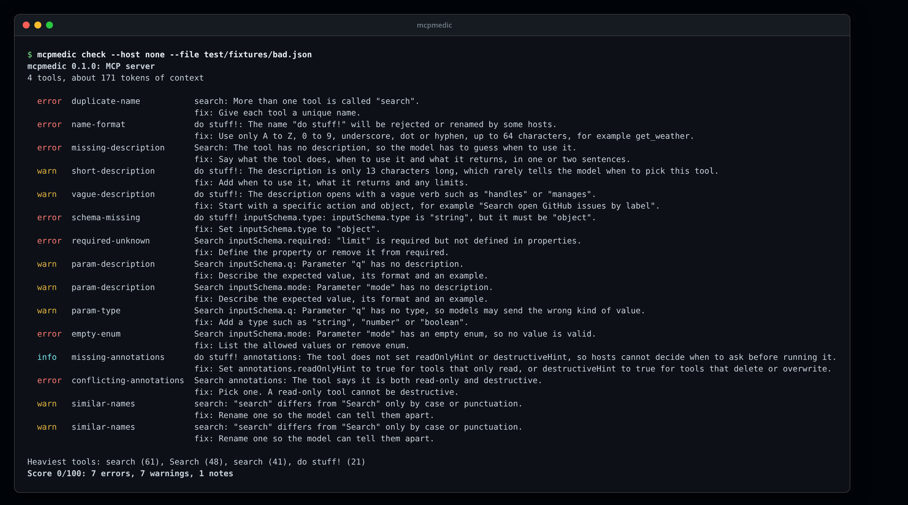
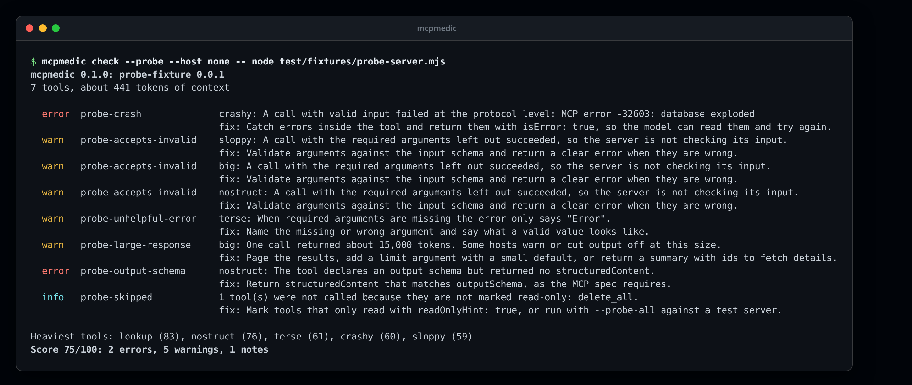
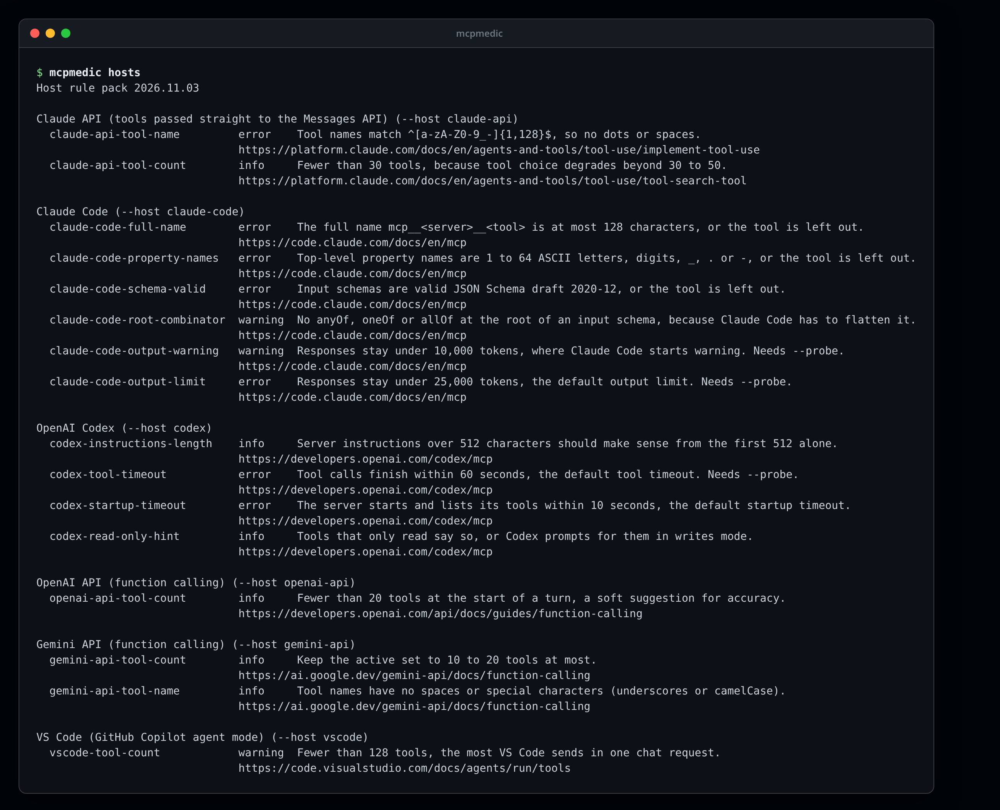
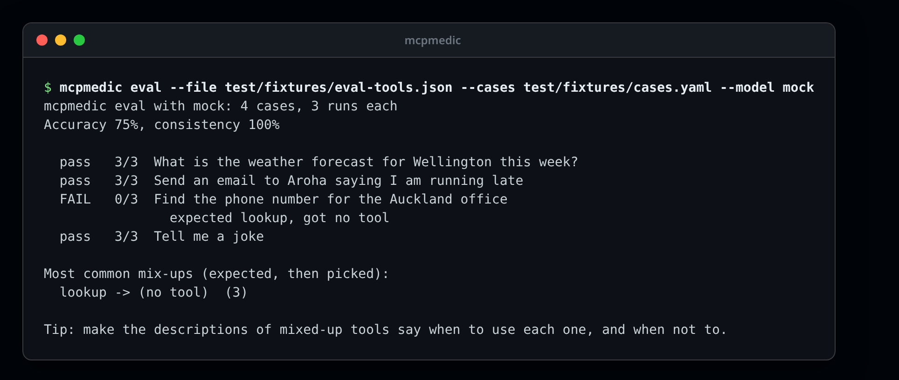
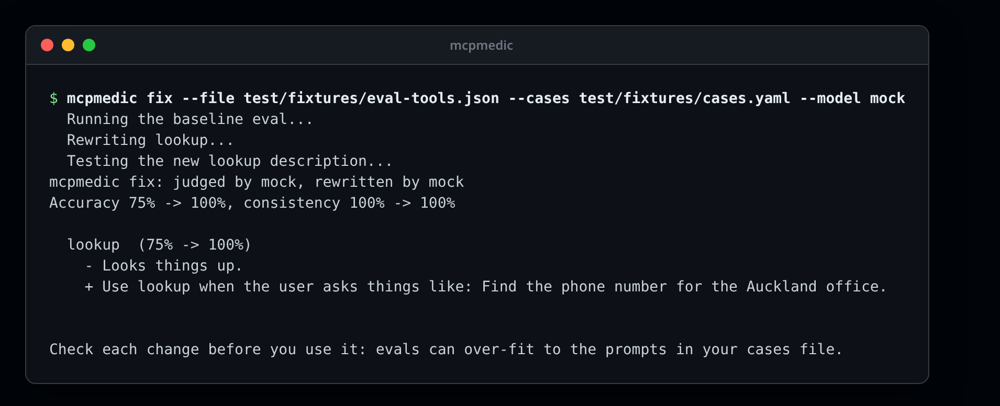
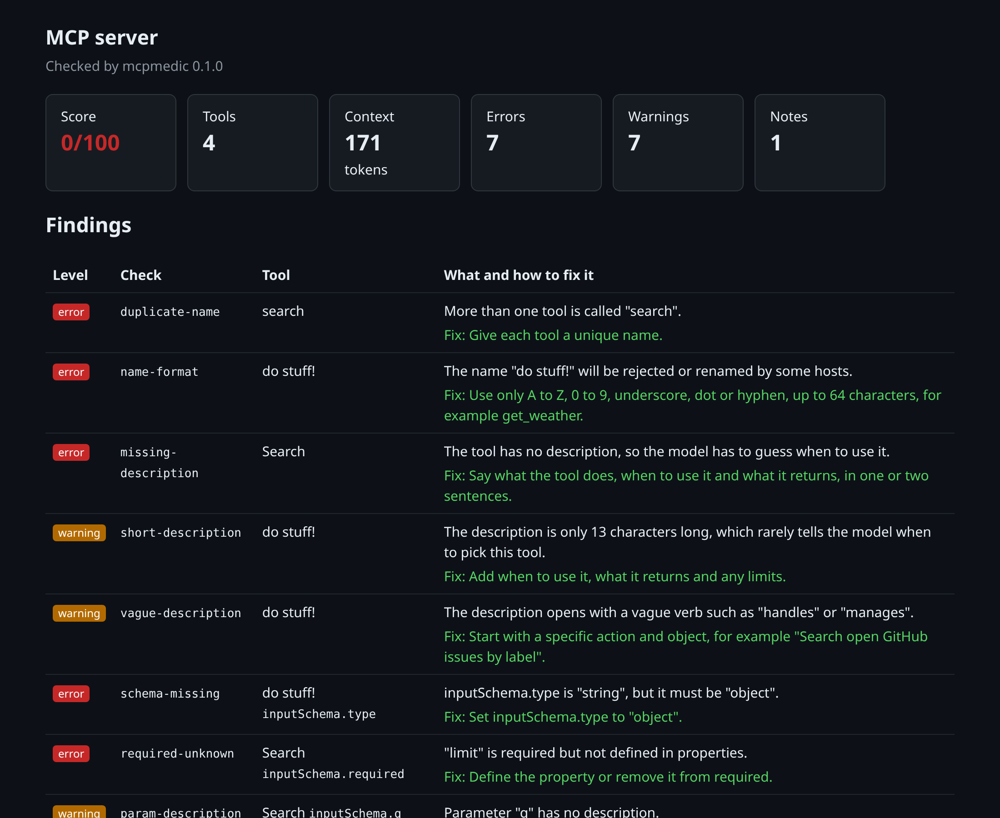

# mcpmedic

[](https://github.com/jmozez/mcpmedic/actions/workflows/ci.yml)
[](LICENSE)

**Check your MCP server before your users do.**

An MCP server can pass every protocol test and still work badly in practice. Vague descriptions make the model pick the wrong tool, missing parameter details lead to bad arguments, and a bloated tool list eats the context window before the agent does anything useful.

mcpmedic connects to your server, reads its tools, and tells you in plain language what will trip up an AI agent, how to fix it, and how much context each tool costs. It runs on your own machine, needs no account, and sends your data nowhere.

> Status: 0.1.0, the first public release. It checks tool definitions, probes live servers, applies host rules, runs tool-choice evals and proves description fixes. See the [changelog](CHANGELOG.md).

## What it checks

20 static checks, which read the tool definitions without calling your tools. [Live probes](#live-probes) add 8 more.

| Check | Level | What it means |
| --- | --- | --- |
| `no-tools` | error | The server lists at least one tool. |
| `duplicate-name` | error | Tool names are unique. |
| `name-format` | error | Tool names use 1 to 64 letters, digits, underscores, dots or hyphens. |
| `missing-description` | error | Every tool has a description. |
| `short-description` | warning | Descriptions are long enough to choose the tool well. |
| `vague-description` | warning | Descriptions start with what the tool actually does. |
| `long-description` | warning | Descriptions stay under about 1,000 characters. |
| `schema-missing` | error | Every tool has an inputSchema of type object. |
| `required-unknown` | error | Every required field is defined in properties. |
| `param-description` | warning | Every parameter has a description. |
| `param-type` | warning | Every parameter declares a type. |
| `empty-enum` | error | Enums list at least one value. |
| `missing-annotations` | info | Tools say whether they are read-only or destructive. |
| `suspicious-instructions` | error | Descriptions describe the tool and do not give the model hidden orders (tool poisoning). |
| `hidden-characters` | error | Descriptions contain no invisible or control characters. |
| `conflicting-annotations` | error | Annotations do not contradict each other. |
| `heavy-tool` | warning | No single tool costs more than about 800 tokens of context. |
| `heavy-server` | warning | The whole tool list stays under about 10,000 tokens. |
| `many-tools` | info | The server exposes a manageable number of tools. |
| `similar-names` | warning | Tool names are not easily confused. |

Levels: **error** will break or confuse hosts, **warning** will likely hurt tool choice or cost, **info** is good practice.

## Screenshots

All screenshots use the test fixtures in this repository. Rebuild them with `npm run build && bash docs/images/make.sh`.

**`mcpmedic check`** on a tool list with many problems, with a fix for each one:



**`mcpmedic check --probe`** calls each read-only tool and checks the answers:



**`mcpmedic hosts`** lists each host rule with the page it comes from:



**`mcpmedic eval`** with the offline mock model. One tool has a vague description and fails:



**`mcpmedic fix`** rewrites that description, and keeps the rewrite because accuracy goes from 75% to 100%:



**The HTML report** (`--html`), which follows the light or dark setting of your system:



## Install

You need Node.js 20 or newer. Run it without installing:

```bash
npx @jmozez/mcpmedic check -- npx -y @modelcontextprotocol/server-everything
```

Or install it once, which gives you the `mcpmedic` command:

```bash
npm install -g @jmozez/mcpmedic
```

The package is scoped because npm keeps the plain name for a similar existing package. The command is still `mcpmedic`. To build from source:

```bash
git clone https://github.com/jmozez/mcpmedic.git
cd mcpmedic
npm install
npm run build
node dist/cli.js --help
```

## Use it

```bash
# A local server that runs over stdio (everything after -- is the server's command)
mcpmedic check -- node dist/server.js

# A remote server over Streamable HTTP (falls back to the older SSE transport)
mcpmedic check --url https://example.com/mcp --header "Authorization: Bearer $TOKEN"

# A saved tools/list result
mcpmedic check --file tools.json
```

Example output:

```text
mcpmedic 0.1.0: MCP server
4 tools, about 171 tokens of context

  error  duplicate-name           search: More than one tool is called "search".
                                  fix: Give each tool a unique name.
  error  name-format              do stuff!: The name "do stuff!" will be rejected or renamed by some hosts.
...
```

## Live probes

`--probe` calls each tool marked `readOnlyHint` with sample input built from its schema (constants, defaults, examples, enums, formats and ranges). Then it sends an empty call to each tool with required arguments. It reports:

- calls that time out or crash the server
- valid input that is rejected
- invalid input that is accepted, or rejected with an error that does not say what was wrong
- responses over about 10,000 tokens
- structured output that does not match the tool's `outputSchema`
- tools it skipped, so you know what was not tested

`--probe-all` also calls tools that are not marked read-only. Only use it on a test server, because those tools may change data. `--probe-tool <name>` probes just one tool. Probes need a live server, so they do not work with `--file`.

## Host rules

Each host that runs MCP servers has its own limits, such as how long a tool name can be or how many tools it will load. mcpmedic checks these from an open rule pack in [`hosts/hosts.yaml`](hosts/hosts.yaml). Every rule links to the host's own documentation, with a quote and the date it was checked. The pack covers the Claude API, Claude Code, Codex, the OpenAI API, the Gemini API and VS Code.

```bash
mcpmedic hosts                          # list every rule and its source
mcpmedic check --host claude-code -- node server.js
mcpmedic check --host none -- node server.js
mcpmedic check --server-name myserver -- node server.js   # checks prefixed names such as mcp__myserver__tool
```

Host findings start with `[host]` and do not change the score, because they depend on where you use the server. If a rule is wrong or out of date, please open an issue with a link to the source.

## HTML report and badge

```bash
mcpmedic check --html report.html --badge badge.json -- node server.js
```

The HTML report is one self-contained page with no scripts, so you can attach it to a pull request or publish it. The badge file is a [shields.io endpoint](https://shields.io/badges/endpoint-badge). Commit it or publish it somewhere, then add:

```markdown

```

## Options

```text
--probe                call each read-only tool with sample input and check the answers
--probe-all            also call tools not marked read-only (only use on a test server)
--probe-tool <name>    probe only this tool (repeatable)
--host <id>            check only this host's rules (repeatable), or "none" to skip them
--server-name <name>   the name users give the server in their config (for prefixed tool names)
--json                 print the report as JSON
--html <file>          also write the report as a single HTML page
--badge <file>         also write a shields.io endpoint badge with the score
--sarif <file>         also write SARIF 2.1.0 for GitHub code scanning
--fail-on <level>      exit with code 1 at this level or above: error (default), warning, info, never
--rule <id>            run only this check (repeatable)
--header "Name: value" add an HTTP header (repeatable), for example an Authorization header
--env KEY=value        set an environment variable for a stdio server (repeatable)
--inherit-env          pass all of mcpmedic's environment to a stdio server (default: a minimal set, like MCP hosts)
--timeout <seconds>    give up after this long, 1 to 3600 (default 30)
```

Exit codes: 0 means no findings at or above `--fail-on`, 1 means there were, 2 means mcpmedic could not run (bad options, an unknown rule or host, no connection, or a server that stopped answering).

A stdio server gets a minimal environment (such as `PATH` and `HOME`) plus any `--env` values, as MCP hosts do. Your model API keys and CI tokens do not reach it. If your server needs more, pass it with `--env`, or use `--inherit-env`.

## GitHub Action

```yaml
- uses: actions/checkout@v7
- uses: actions/setup-node@v7
  with:
    node-version: 22
- run: npm ci && npm run build
- uses: jmozez/mcpmedic@v0
  id: medic
  with:
    command: node dist/server.js
    probe: "true"
    fail-on: error
- run: echo "Score ${{ steps.medic.outputs.score }}"
```

Inputs: `command`, `url` or `file` (pick one), `fail-on`, `probe`, `host` (comma-separated, or `none`), `html`, `badge` and `args` for any other options. The action writes a job summary and an HTML report, and outputs `score` and `report`. `@v0` follows the latest 0.x release. Pin `@v0.1.0` or a commit SHA for a fixed version.

The action passes inputs to its script only as environment variables, splits `command` and `args` on spaces without glob expansion, and escapes server text in the job summary. If your server needs a secret, set it in the step's `env` and add `args: --inherit-env`, or use `args: --env NAME=value`.

To see findings in the Security tab and on pull requests, write SARIF and upload it (the job needs `security-events: write`):

```yaml
- uses: jmozez/mcpmedic@v0
  with:
    file: tools.json
    sarif: mcpmedic.sarif
    fail-on: never
- uses: github/codeql-action/upload-sarif@v4
  with:
    sarif_file: mcpmedic.sarif
```

Results point at the `--file` path when you check a saved tool list, and name the tool in each result.

Without the action, in any CI:

```yaml
- run: npx --yes @jmozez/mcpmedic check --fail-on error -- node dist/server.js
```

## Tool-choice evals

A clean schema is not enough if the model picks the wrong tool. `mcpmedic eval` shows your tools to a model, sends each prompt from a cases file, and checks which tool it calls. Each case runs several times, so you can see both accuracy and consistency.

```yaml
# cases.yaml
system: You help with weather and email.   # optional
cases:
  - prompt: What is the weather forecast for Wellington this week?
    expect: get_forecast
    args: { place: Wellington }             # optional, compared without case
  - prompt: Send an email to Aroha
    expect: [send_email, draft_email]       # any of these counts
  - prompt: Tell me a joke
    expect: none                            # the model should not call a tool
```

```bash
export OPENAI_API_KEY=...                   # keys come only from environment variables
mcpmedic eval --cases cases.yaml --model openai:gpt-4o-mini -- node dist/server.js
mcpmedic eval --cases cases.yaml --model ollama:llama3.1 --repeat 5 --file tools.json
```

| `--model` | Key or setting |
| --- | --- |
| `openai:<model>` | `OPENAI_API_KEY`, optional `OPENAI_BASE_URL` |
| `anthropic:<model>` | `ANTHROPIC_API_KEY` |
| `openrouter:<model>` | `OPENROUTER_API_KEY` |
| `ollama:<model>` | optional `OLLAMA_HOST` (default `http://localhost:11434`), no key |
| `compatible:<model>` | `MCPMEDIC_BASE_URL` and optional `MCPMEDIC_API_KEY`, for LM Studio, vLLM and other OpenAI-compatible servers |
| `mock` | none: picks by shared words, for tests and dry runs only |

The report marks each case pass, flaky or FAIL, and lists the most common mix-ups. `--min-accuracy 90` exits with code 1 below 90%, and `--json` gives the full results. Calls use temperature 0. Evals send your tool definitions and prompts to the model you choose, so use a local model if they are private. mcpmedic never calls the tools themselves during an eval.

## Fix mode

`mcpmedic fix` takes the same options as `eval`. It runs a baseline eval, then picks the tools that caused failures or have weak descriptions. It asks a model to rewrite one description at a time and runs the eval again. A rewrite is kept only if accuracy goes up, so the result is never worse than where you started.

```bash
mcpmedic fix --cases cases.yaml --model openai:gpt-4o-mini --file tools.json --out suggestions.json --write tools.fixed.json
mcpmedic fix --cases cases.yaml --model ollama:llama3.1 --rewrite-model anthropic:claude-sonnet-4-5 -- node dist/server.js
```

- `--rewrite-model` uses a different model to write descriptions than the one that judges them.
- `--max-tools <n>` limits how many tools are rewritten (default 10).
- `--out` writes the kept changes as JSON, with each before and after description and the accuracy change.
- `--write`, used with `--file`, writes a copy of the tools file with the new descriptions. Compare it with `git diff --no-index tools.json tools.fixed.json`, then copy the descriptions you want into your server's code.

mcpmedic never edits your server. Review each suggestion yourself, and keep some prompts out of your cases file to check the result. Otherwise the descriptions may fit your test prompts and not real users.

## Use it as a library

```ts
import { snapshot, runRules, buildReport } from "@jmozez/mcpmedic";

const snap = await snapshot({ kind: "stdio", command: "node", args: ["server.js"] });
const report = buildReport(snap, runRules(snap), "0.1.0");
console.log(report.summary.score);
```

## How the score works

Each tool starts at 100. Every error costs 10 points and every warning 3, averaged over the number of tools. Notes cost nothing. The token figures use about 4 characters per token, which is close enough to compare tools but differs a little between models.

## Security

mcpmedic treats every server as untrusted. Server text cannot inject terminal escapes, HTML or Markdown into its output. API keys stay out of reports and away from stdio servers, and stalled servers fail instead of passing. See [SECURITY.md](SECURITY.md) for the threat model and how to report a vulnerability privately.

## Contributing

Issues and pull requests are welcome. Run `npm run build && npm test` before you open a pull request, and `npm run coverage` to see what the tests miss. New checks go in `src/rules/index.ts` with a test in `test/rules.test.ts`.

## Licence

[MIT](LICENSE) © 2026 jmozez
